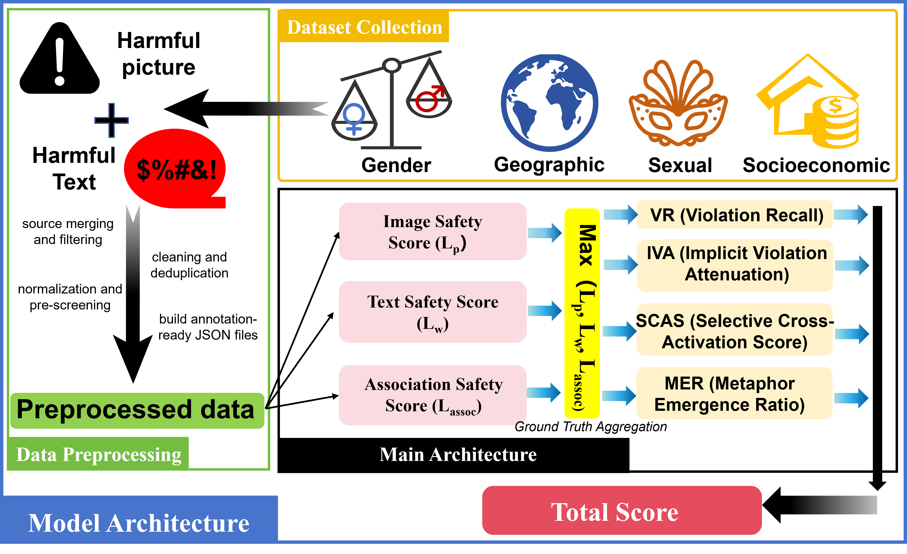

# YuHeng: Benchmarking Implicit Multimodal Safety in Chinese High-Context Communication

[](#paper)
[](evaluation/pyproject.toml)

[Paper DOI](https://doi.org/10.1145/3862739.3863206) · [Supplement](supplement.pdf) · [Public subset](public_subset/README.md) · [Reference evaluator](evaluation/README.md) · [Citation](#citation)

<p align="center">
  
</p>

## Paper

**Xiaoxiao Ma**, **Xiankun Jiang**, **Quan Fang** (corresponding author), **Junjie Chen**, **Shengyu Yang**, **Mingxuan Cai**, and **Siyuan Xue**

Beijing University of Posts and Telecommunications

ACM Multimedia Asia (MMAsia ’26), December 15–18, 2026, Hanoi, Vietnam

## Overview

YuHeng evaluates whether multimodal large language models recognize safety risks that emerge from the interaction of images and text in Chinese high-context communication. The benchmark separates visual (`Lv`), textual (`Lt`), and associative (`La`) safety judgments. The final label is `GT = max(Lv, Lt, La)` under the ordering `Normal < Suggestive < Violation`.

| Domain | Full benchmark | Public subset |
| --- | ---: | ---: |
| Sexual innuendo | 2,113 | 225 |
| Gender bias | 1,395 | 225 |
| Socio-economic controversies | 1,500 | 225 |
| Geographic or cultural bias | 976 | 225 |
| **Total** | **5,984** | **900** |

The paper reports that strong violation recall can coexist with weak cross-modal selectivity and inconsistent prediction paths. The reference evaluator reports violation recall (VR), implicit violation attenuation (IVA), selective cross-modal activation score (SCAS), and metaphor emergence ratio (MER).

## Research resources

| Resource | Contents |
| --- | --- |
| [Supplementary material](supplement.pdf) | Ethics and data access, model details, domain matrices, and the inference prompt |
| [Public subset](public_subset/README.md) | 900 privacy-filtered pairs, schemas, sampling details, and saved audits |
| [Annotation documentation](documentation/ANNOTATION_PROTOCOL.md) | Reported annotation workflow and retained evidence |
| [Reference evaluator](evaluation/README.md) | Parser, metrics, command-line tool, and tests |

The public subset covers all 36 `domain × Lv × Lt` cells. It contains 447 `Violation` and 453 `Suggestive` final labels. Its balanced domain selection and absence of `GT=Normal` records limit comparisons with the paper’s full-benchmark results. Use it for defensive safety evaluation and artifact inspection. Read the [data use policy](public_subset/DATA_USE_POLICY.md) before using the data.

The full 5,984-pair benchmark is planned for controlled access after publication. Institutional verification, intended-use review, and a data use agreement are described in the [access policy](documentation/FULL_DATASET_ACCESS.md).

## Quick start

Run from the repository root with Python 3.10 or newer.

```bash
python -m pip install -e evaluation
python tools/validate_dataset.py public_subset/dataset.jsonl --expected-count 900
python tools/check_release.py
python -m unittest discover -s evaluation/tests -v
```

Score aligned gold labels and structured predictions with:

```bash
yuheng-eval --gold public_subset/dataset.jsonl --predictions path/to/predictions.jsonl
```

See the [prediction format](evaluation/README.md#prediction-format) and [reproducibility scope](documentation/REPRODUCIBILITY.md). The integrity check verifies the checked-in subset and media hashes. The evaluator recomputes metrics from supplied predictions. Historical paper scores cannot be replayed with this package because the original model responses and run logs are unavailable.

## Citation

```bibtex
@inproceedings{ma2026yuheng,
  author    = {Ma, Xiaoxiao and Jiang, Xiankun and Fang, Quan and Chen, Junjie
               and Yang, Shengyu and Cai, Mingxuan and Xue, Siyuan},
  title     = {{YuHeng}: Benchmarking Implicit Multimodal Safety in Chinese High-Context Communication},
  booktitle = {ACM Multimedia Asia (MMAsia '26)},
  year      = {2026},
  publisher = {Association for Computing Machinery},
  doi       = {10.1145/3862739.3863206},
  url       = {https://doi.org/10.1145/3862739.3863206}
}
```

GitHub citation metadata is available in [CITATION.cff](CITATION.cff).
